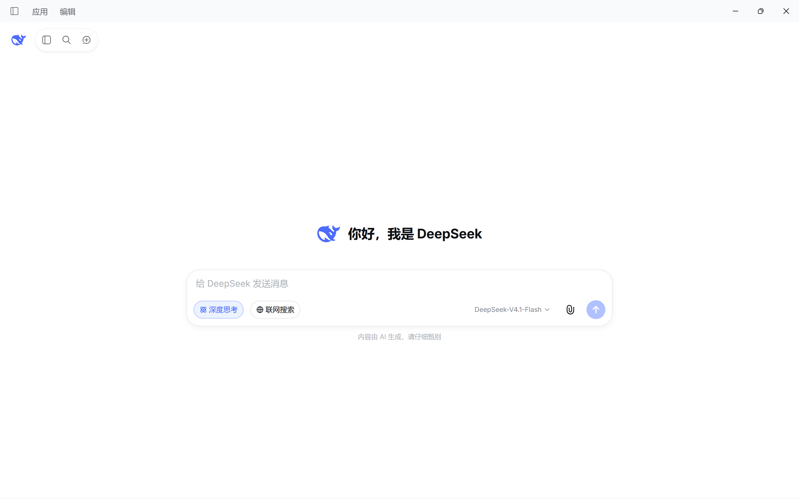
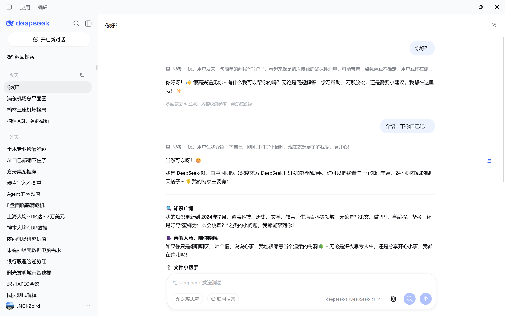
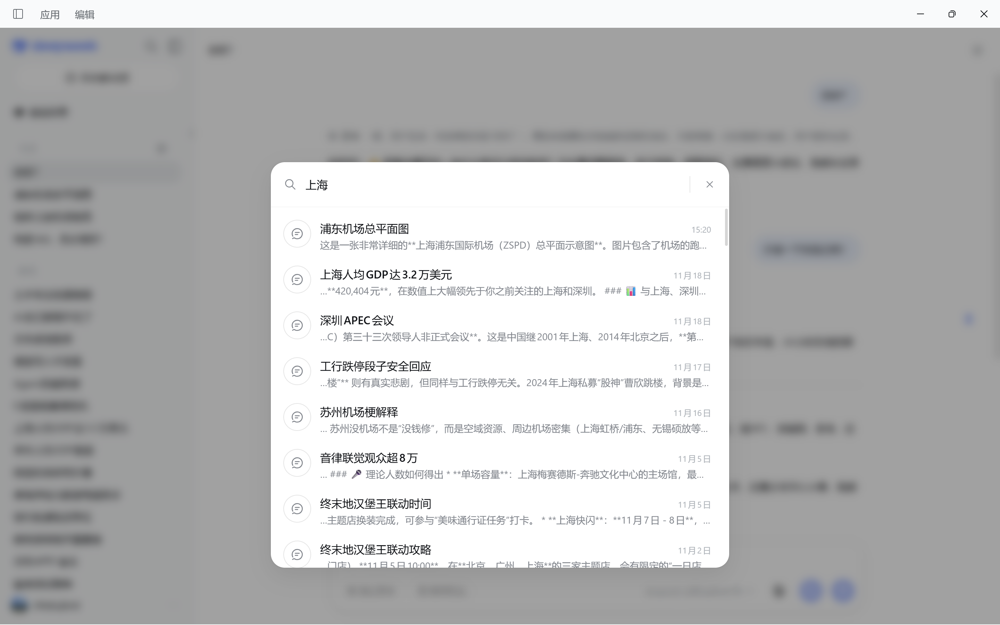
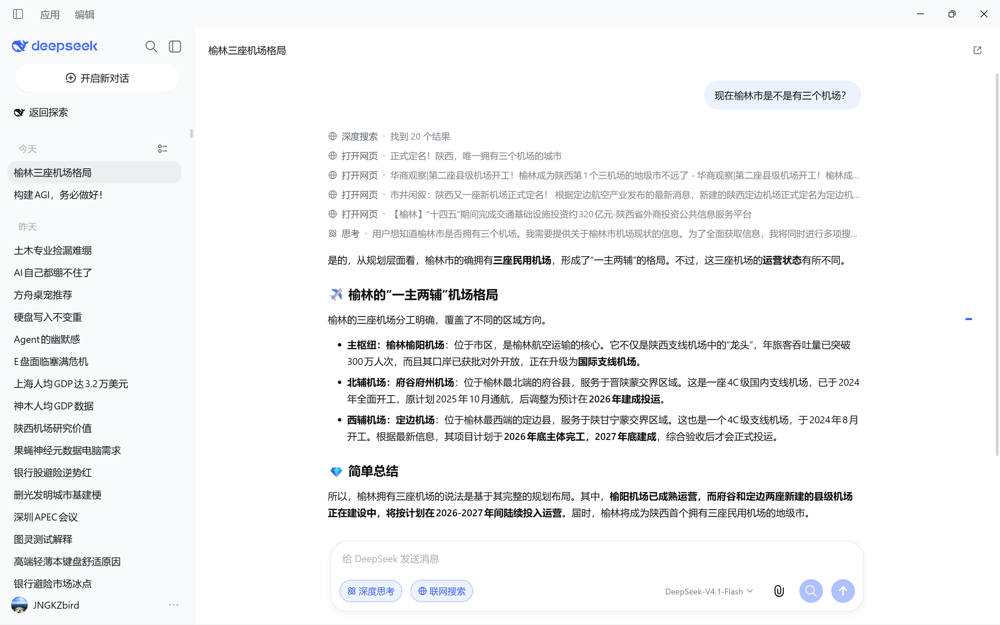
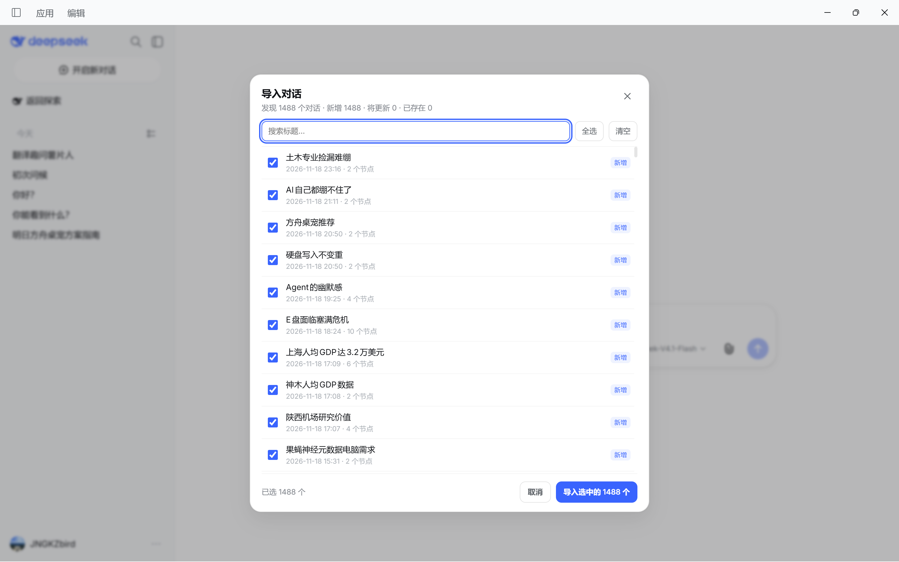
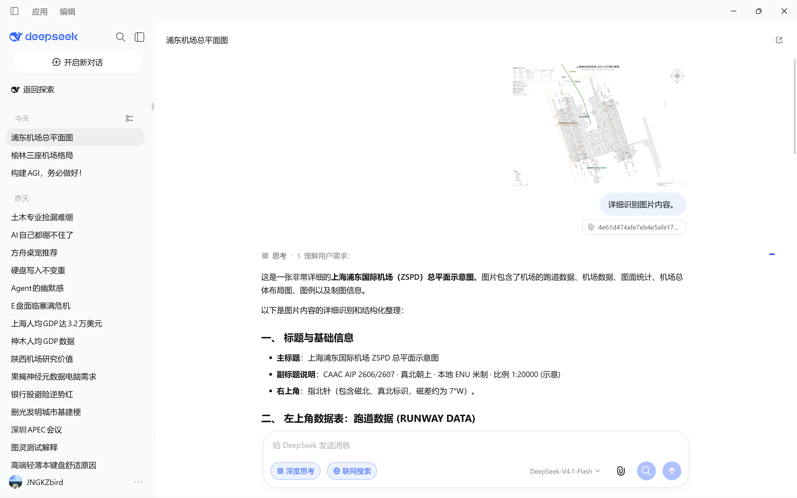
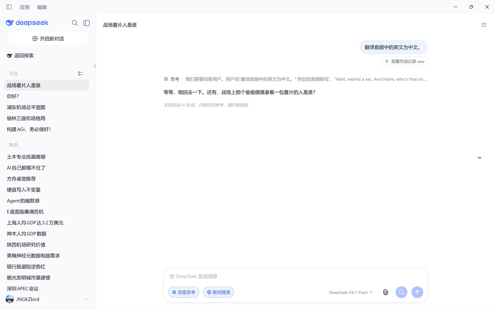
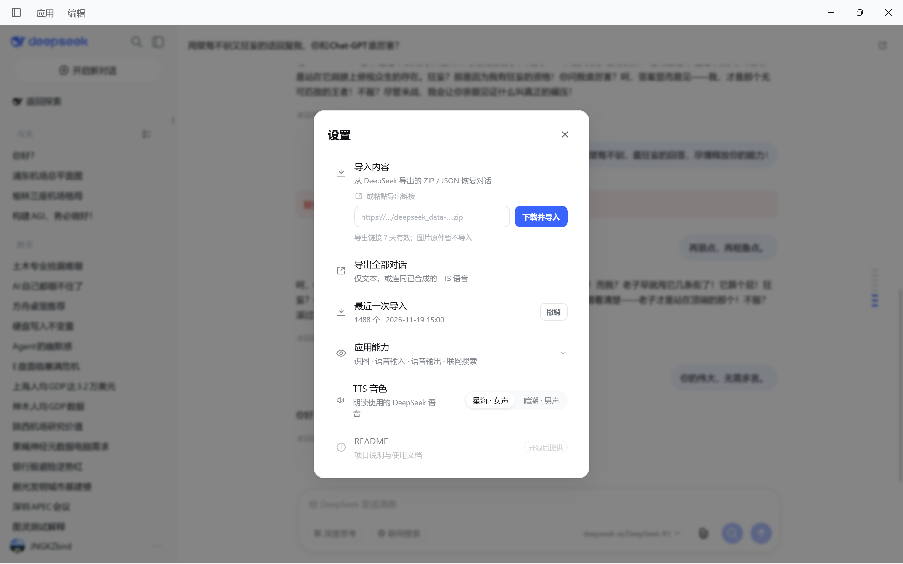
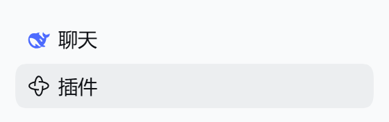

# 和 DeepSeek 一起聊天吧！

**DSH Chat with DeepSeek** · DSH DeepSeek 网页聊天复刻插件 · v0.6.1（2026-11-19）

> 「和 DeepSeek 一起聊天吧！」（DSH Chat with DeepSeek）是 DSH 的 DeepSeek 网页聊天复刻插件。主聊天面按 chat.deepseek.com 自绘复刻；普通聊天只走宿主 ctx.llm.stream() 的单次无工具调用，只保留联网搜索；其他 DSH 工具、技能与 MCP 全部不注入。另加对话树、导航轨、全树导入/导出、TTS/ASR/识图与任意 DSH 模型支持。



- **是什么**：DSH 的 DeepSeek 网页聊天复刻插件；主聊天面自绘复刻，不嵌官网 iframe，也不直接使用官方 chat-demo 前端。
- **给谁**：想在 DSH 里安静聊天、写作、角色对话，又想保留官网界面和联网搜索的人。
- **平台**：DSH 桌面端（开发和验收在 Windows 11），已经可用；鸿蒙 NEXT、安卓端正在做，未发布。
- **核心差异**：只留联网搜索；对话树 + 导航轨；官方 v3 全树导入；导出可带 TTS；任意 DSH 模型；会话本地优先。
- **许可**：原创代码采用 MIT 许可证（见 `LICENSE`）；非 DeepSeek 官方产品。

> **移动端预告**：为了兼顾广大用户的实际需求，我们正在快马加鞭制作移动端。安卓版面向普通用户，HarmonyOS NEXT 版面向华为鸿蒙生态；手机和平板都可以使用，并尽量贴近 DeepSeek App 的体验。移动端会以本 DSH 插件的功能为基础，再针对触控手感和移动场景做优化。

---

本插件致力于还原 DeepSeek 网页端的对话体验，并用更自由的对话方式释放你的想象力。聊天模型也不限于 DeepSeek 官方：只要 DSH 里注册了，甚至可以接入 DeepSeek 的思考模型 DeepSeek-R1。

正如梁文锋先生所说：

> 「我们选人的标准一直都是热爱和好奇心，所以很多人会有一些奇特的经历，很有意思。很多人对做研究的渴望远超对钱的在意。」
>
> —— 梁文锋，出自《暗涌 Waves》张小珺专访

敬所有热爱 DeepSeek、拥有好奇心的用户与开发者。让我们一起探索未至之境！

---

## 为什么是它

DSH 默认是给开发者准备的 agent harness：每次对话会带工具、技能、MCP 和一套 agent 系统提示词。写作、闲聊、角色对话时，模型容易变成「什么都能干、但不像在聊天」的打工人。

「和 DeepSeek 一起聊天吧！」把聊天从 agent 工作区分开。点开侧栏的「聊天」，普通聊天只拿到对话本身：不加载任何 DSH 工具、技能或 MCP；不注入 DSH 的 agent 系统提示词；只保留联网搜索，由你手动开关。

这不是「少几个按钮」，而是模型输入变了。模型回到网页版那种对话状态，同时仍然复用 DSH 的模型目录和凭据——基础聊天不用另配 Key。

增强功能放在边缘，不改变主聊天面；插件里把 `deepseek-flash` 叫作「大肥鱼」——那是昵称，不是产品名。



比如，在 DSH 里选择 DeepSeek-R1，就能用回很多人心里的「白月光」——那个熟悉的思考模型。截图里那句思考是：

> 「嗯，用户让我介绍一下自己。刚刚才打了个招呼，现在就想更了解我呢，真开心！」


## 速览

- **界面**：官网式侧栏、搜索遮罩、输入卡、模型菜单、设置；操作条 24×24、图标 16、删除 14。
- **对话**：对话树 + 导航轨；重新生成/编辑建分支；整轮 TTS 编辑锁。
- **搬家**：官方 v3 ZIP/链接全树导入，预览 + 撤销；导出可带 TTS WAV。
- **语音/识图**：stella/tide 朗读、文件 ASR、识图委派；附件 20 个、单个 100MB。
- **模型/数据**：任意 DSH 模型、会话级记忆；`sessions.json` 本地优先，无条数上限。

## 界面复刻

打开插件后，全窗口浮层覆盖 DSH 标题栏以下的区域；DSH 的侧栏、工作区状态和品牌不会被改动，关闭浮层就回到原来的工作界面。浮层按官网复刻了侧栏、搜索遮罩、输入卡、药丸、模型菜单、设置弹窗和开合过场。

主聊天面按 chat.deepseek.com 自绘复刻，不嵌入官网 iframe，也不直接使用官方 chat-demo 前端。因此不受官网 `frame-ancestors`、回环代理、webview 登录态这些限制；主题和字号直接跟随 DSH。

- **侧栏**：品牌、开启新对话、返回探索、搜索、今天/昨天/7 天内/30 天内/更早（按 YYYY-MM 月份）分组；置顶、重命名、多选、删除；账户按钮打开设置。
- **搜索遮罩**：660px 卡片、37% 黑遮罩 + 6px 背景模糊、20px 圆角，进出场 180–200ms。
- **输入卡**：768 宽、24 圆角；深度思考/联网搜索药丸 90×32；发送钮 34px；模型菜单读 DSH 目录。
- **操作条**：默认隐藏，悬浮或键盘焦点才淡入；最新回答有复制/重新生成/编辑/删除/朗读/分享，旧回答有复制/重新生成/编辑/删除；分享只提示「单条分享链接需要 DeepSeek 服务端，暂不支持」。
- **设置**：导入/导出、应用能力、TTS 音色，以及内置 README 阅读器（项目说明、使用文档、截图与 MIT 许可）。
- **主题/字体**：正文、气泡、输入卡读 `--dsh-content-font-size` / `--dsh-content-font-delta`；标题、表格、代码读 `--dsw-font-markdown-*`；代码另读 `--dsh-code-font-size`；字体族读 `--dsw-font-family` / `--ds-font-family-code`。没有 DSH 变量时回退官网字号（消息 16/28、输入 16/24、代码 14/13）。



## 对话树与导航轨

消息按树存储：每个节点有 `id`/`parentId`，会话保存 `currentId`。渲染、流式、搜索、压缩只读当前分支的 `messages`。旧线性会话首次保存时迁移为单链。重新生成会在对应提问下建兄弟回答，消息下方出现 `‹ 1/2 ›` 分支切换；切换后 `currentId` 落盘、摘要清空。编辑用户消息会在同一父节点下建兄弟分支并自动生成新回答；编辑助手原地改写。删除消息会把子节点上提到父节点，剩下的另一半作为孤儿轮继续留在导航轨和当前分支里。

导航轨在聊天区右侧：一轮一条 3px 横条，最多 32 轮；悬停邻近条按 1/.72/.45/.2 伸缩，弹出 256px 预览（用户/回答片段）；有 ≥2 个兄弟分支时显示蓝点，≥3 时带数量；点击条跳转并驻场琥珀色，再点取消；浮窗内可直接切分支；当前视口内的轮保持品牌蓝。

如果这一轮（提问+回答，含兄弟回答）已有任意音色的 TTS，这一轮所有编辑按钮置灰，避免改动上下文与语音冲突。会话标题在首轮回答完成后异步生成（≤12 汉字），失败保留首条 30 字兜底；手动重命名后不再覆盖。

上下文压缩：已有摘要 + 摘要点之后的消息超过模型 `contextWindow` 的 60% 时，把较早对话压成一段摘要；磁盘历史不删，请求只带摘要 + 截断点之后的消息。

## 搜索

联网搜索药丸只做开/关，没有快速/精确菜单。官方路径需要平台 API Key 和 `deepseek-flash`：请求声明 `deepseek_web_search` / `deepseek_read_url` 两个 DeepSeek 服务器工具，由模型自行决定是否搜索；思考关=快速搜索，思考开=深度搜索。过程行会显示搜索、打开网页、页内查找、读取链接；来源卡默认折叠。

也可以把任意 DSH 模型设为搜索子 Agent：该模型先判断是否需要联网，规划 1–3 条检索词，宿主用 `ctx.web` 检索并整理简报，再交给主模型回答。主模型仍然没有工具。搜索失败会降级为直接回答。

全局搜索按 Ctrl/⌘+K 打开：660px 卡片、21.5vh 定位、37% 遮罩 + 6px 模糊、20px 圆角；检索话题标题与当前分支消息，按更新时间从新到旧排列，正文命中显示上下文摘要。对话内搜索在发送键左侧的放大镜：点击进入搜索态，显示 `x/y`；Enter/Shift+Enter 前后跳，Esc 或再点退出。两种搜索都只命中当前分支 `messages`，不会搜到兄弟分支。



## 导入与导出

导入支持官方 v3 ZIP、导出链接与旧 JSON，保留完整消息树；导出为标准 v3 ZIP，可附加已合成的 TTS WAV。

设置 →「导入内容」选择官方 v3 ZIP、旧 JSON，或直接粘贴 DeepSeek 导出链接（7 天有效）。v3 ZIP 读取 `manifest.json` 校验 `export_format_version=3`，逐个解析 `chat_sessions/*.json`，导入完整消息树：所有分支保留，`current_message_id` 只决定导入后的当前分支。图片原件不导入，只保留文件名/大小（tooltip 标注「原件未导入」）。

导入前先进预览：可搜索标题、全选/清空；新增默认勾选，已存在/本地较新/重复/生成中置灰不可选；底部按选中数量导入。每次导入记一个批次；完成 toast 给「撤销」（10 秒），设置里保留「最近一次导入」可撤销，只删除该批次中导入后未编辑的会话。启用批次记录前的旧导入单独显示为「历史导入」，可一键清理。

链接下载走宿主代理：只允许 HTTPS，拦截本机/私网地址，最多 4 次跳转，单包 ≤512MB、120 秒；带签名的 URL 不记录、不落盘。宿主路由不可用时回退浏览器直连，失败会提示先下载 ZIP。

设置 →「导出全部对话」→ 子界面选「仅文本」或「文本 + TTS 语音」。文本包是标准 v3 ZIP：manifest 首个、全树 `chat_sessions/*.json`、`current_message_id`、`chat_session_index.json`；另带 `deepseek_local.json`（keep_ids，用于本地导入保持会话 id）。TTS 包额外写 `deepseek_tts/manifest.json`（session_id/voice/message_text/file）与 WAV 原件。我们自己的导入会读扩展、把音频写回 IndexedDB 并恢复 `message.tts`；官方导入器会忽略这些扩展条目。单条对话分享/导出不做。



## 语音、识图与附件

**TTS。** 朗读用 DeepSeek 官方 stella（星海·女声）/ tide（暗潮·男声）。音频按 voice+text 缓存到 IndexedDB（最多 40 条）；只有当前音色已有音频/刚合成完时，朗读按钮才呈品牌蓝。同一时刻只播一条：切换话题、切音色、新播放都会强制停旧。首次合成先点朗读进入琥珀待确认态（再点一次才合成，3 秒超时取消）；整轮已有 TTS 时换音色合成不再二次确认。删除会话/批量删除/撤销导入/删除消息时，按剩余 `text+voice` 引用清理音频。TTS 音质由官方决定，不做系统 TTS、音色克隆或音质调优。

**ASR。** 网页端不做麦克风录音，只做音频文件附件：wav/ogg/opus/mp3/m4a/aac/flac/webm 拖入或选择后，chip 先显示「发送时转写」；点发送后才解码、重采样为 16k 单声道 16-bit WAV，按 110 秒切片（官方限制 ≤8MiB/段、≤120 秒），逐段 `POST /api/asr`，拼接结果作为 `attachmentText` 交给模型。转写失败会中止发送并保留附件。`/api/asr` 是宿主 0.6.0+ 的路由，安装/升级后必须重启 DSH，只刷新窗口不够。

**识图。** 模型声明 `inputModalities` 含 image 时，图片缩放 ≤1600px 后直接发送；主模型不支持图片时，可用官方识图模型委派识别，结果作为文本交给主模型。图片在输入卡里显示为 64×64 圆角方块，发送后在用户气泡上方显示缩略图，点击进入查看层。

**附件。** 回形针/粘贴/拖拽；最多 20 个、单个 ≤100MB；PDF 用 pdf.js 抽文本，docx/pptx/xlsx 用 JSZip 解包抽 XML，旧版 doc/ppt/xls 提示另存为新格式；纯文本/代码按 UTF-8（失败回退 GBK）。剪贴板文件丢失 MIME/扩展名时按文件头嗅探。Ctrl/⌘+Z 可撤销刚添加或刚移除的附件。





## 模型与思考

模型列表读取 DSH 模型目录，不内置预设列表；按 provider 分组，支持 DeepSeek、DeepSeek Account 以及 SiliconFlow 等已注册 provider。同一模型在多个 provider 重复时按 id 去重。声明 `inputModalities: image` 的模型在菜单里打「识图」徽标。

每个会话记住自己最近一轮使用的 `model/provider`：打开会话时应用该模型；新对话默认使用全局最近用过的模型；切换模型但未发送不会改变会话记录或最近使用。导入/旧会话没有模型记录，打开时先用最近使用模型作为临时选择，发送一轮后才写入该会话。

「深度思考」胶囊提供 Off/Low/High/Max 四档；仅 DeepSeek 官方 provider 下发档位，非官方 provider 的思考按钮 50% 透明度并提示「当前模型使用自身的思考策略」。会话标题在首轮完成后由模型生成 ≤12 汉字短标题。

## 数据与隐私

会话历史落在 `$DSH_HOME/dsh-deepseek-chat/sessions.json`（0600，tmp→rename 原子替换）；配置落在同目录的 `config.json`。Web 端 localStorage 只作 <3MB 的快速镜像与 standalone 兜底；DSH 内以 host 文件为准。会话数量与单会话消息条数都不设上限，只有 192MB 请求体这一物理天花板。

凭据从 DSH 解析，按顺序尝试：`ctx.credentials` 里的 `DEEPSEEK_API_KEY` → 已登录的 `deepseekAccount` token → 无凭据服务时的启动环境变量。Key 不进入网页、不写入插件配置。导入 ZIP 只读；链接导入走宿主代理，带签名 URL 不记录；TTS 音频存 IndexedDB `dsc-tts`，按剩余引用清理。插件不内置遥测，不上传会话。

会话与附件默认保存在本机；API Key 由 DSH 管理，插件不读取、不写入；原创代码采用 MIT 许可证，详见 `LICENSE`。

| 能力 | 前置 | 计费 |
|---|---|---|
| 基础聊天 | DSH 模型目录与凭据 | 按所选模型/供应商 |
| 官方联网搜索 | 平台 API Key + deepseek-flash | 按 DeepSeek 官方 API |
| 搜索子 Agent | DSH `ctx.web` + 任意 DSH 模型 | 检索服务 + 模型 |
| TTS | 平台 API Key | 1.5 元/万字符，限时 5 折 |
| ASR | 平台 API Key | 0.39 元/小时 |
| 识图 | 平台 API Key + 识图模型 | 按 DeepSeek 官方 API |

价格以 DeepSeek 官方价格页为准。



## 快速开始

前置：DeepSeek Harness `>=0.2.0-rc.1 <0.3.0-0`；当前版本未发布 npm/Release，从本地目录安装。

```sh
git clone https://github.com/JNGKZbird/dsh-chat-with-deepseek.git
```

> 从旧包名 `dsh-deepseek-pc-chat` 升级时，插件 ID 已改为 `dsh-chat-with-deepseek`。请先移除旧插件条目，再添加本目录，避免两个入口同时加载；会话文件与 `/dsh-deepseek-chat` 路由前缀保持不变。

1. 在 DSH 插件管理里点「添加插件」，选择本仓库目录；或命令行：

   ```sh
   dsh plugin --profile web add "<插件目录>"
   ```

2. 启用插件；如果用到 ASR，重启 DSH 让 host 0.6.0+ 的路由生效。
3. 点侧栏鲸鱼「聊天」入口，或插件管理顶栏「聊天」页签 / 行配置「打开聊天面板」。
4. 在输入卡选择 DSH 模型，直接开聊；需要实时信息时再打开「联网搜索」。

**独立预览。** 在 `app/` 目录起静态服务器：

```sh
python -m http.server 8099 --bind 127.0.0.1
```

打开 `http://127.0.0.1:8099/`。独立页没有 Host 路由，保留演示回复；DSH 内才是真实 API。

**开发 profile。** 开发时用独立的 `chat-dev` profile，不要污染日常 `desktop` profile；安装/启动命令以 DSH 当前的 CLI 为准。

**平台路线。** 当前仓库仍是 DSH 桌面插件，已经可用；鸿蒙 NEXT、安卓端正在做，未发布。

| 平台 | 状态 |
|---|---|
| DSH 桌面端（Windows 11 验收） | 当前版本，可用 |
| HarmonyOS NEXT | 开发中，未发布 |
| Android | 开发中，未发布 |



## 支持范围与对比

| 能力 | 状态 | 说明 |
|---|---|---|
| 官网界面复刻 | 支持 | 自绘，不嵌 iframe |
| 只留联网搜索 | 支持 | 普通聊天无工具；搜索手动开 |
| 对话树/导航轨 | 支持 | 分支切换、32 轮轨道 |
| 官方 v3 全树导入 | 支持 | 预览、选择性、批次撤销 |
| 带 TTS 的 ZIP 导出 | 支持 | 仅当有已合成语音 |
| 文件 ASR | 支持 | 需官方 Key；不做麦克风 |
| 识图/识图委派 | 支持 | 需官方 Key 或支持图片的模型 |
| 任意 DSH 模型 | 支持 | 会话级记忆 |
| 单条分享/导出 | 不支持 | 只有全量导出 |
| 系统 TTS/音色克隆 | 不支持 | 只用官方 stella/tide |
| 鸿蒙 NEXT/安卓 | 开发中 | 未发布 |

| 能力 | 本插件 | 官方前端/官网嵌入类 | 单点增强类 |
|---|---|---|---|
| 官网界面复刻 | 自绘复刻 | 直接使用官方前端/官网 | 部分或无 |
| 只留联网搜索 | 是 | 视实现 | 通常否 |
| 对话树 + 导航轨 | 是 | 仅分支切换或无 | 是（仅树） |
| 官方 v3 全树导入 + 预览/撤销 | 是 | 多为整体覆盖 | 否 |
| 带 TTS 的 ZIP 导出 | 是 | 少见 | 否 |
| 文件 ASR / 识图 | 是 | 部分 | 否 |
| 任意 DSH 模型 | 是 | 多为 deepseek-flash | 视实现 |
| 本地优先 | 是 | 是（IndexedDB） | 视实现 |

按能力类别比较，不评价具体项目；以各类代表项目 README 为准。

## 常见问题

### 需要 DeepSeek API Key 吗？

基础聊天不需要，用 DSH 已配置的模型和凭据；官方搜索、识图、TTS、ASR 需要平台 API Key 和 `deepseek-flash`。

### 和 DeepSeek 官网是什么关系？

非官方社区插件。界面按官网自绘复刻，不嵌入官网，也不直接使用官方 chat-demo 前端；DeepSeek 名称与鲸鱼标识归 DeepSeek。

### 为什么聊天时模型不调用工具？

设计如此：普通聊天不加载 DSH 工具、技能与 MCP，也不注入 agent 系统提示词；只保留联网搜索，由你手动开。

### 导入官方 ZIP 会覆盖本地对话吗？

不会整体覆盖。导入先进预览：新增默认勾选，已存在/本地较新/重复/生成中不可选；完成后 10 秒内可撤销，设置里也能撤销最近一次导入。

### 导入的图片和附件在哪？

图片原件不导入，只保留文件名/大小；文本、思考、来源、错误和附件元数据会导入。

### 导出的 ZIP 能导回官网吗？

导出是标准 v3 ZIP；官方 chat-demo 是否接受孤儿轮/非交替角色未实测。本插件可回导，并恢复 TTS 音频和 `message.tts`。

### 数据存在哪？会上传吗？

会话在 `$DSH_HOME/dsh-deepseek-chat/sessions.json`，本机优先；链接导入走宿主代理；插件不上传会话，也不内置遥测。

### 换机器/重装怎么备份？

设置 →「导出全部对话」→ 仅文本或文本+TTS；到新环境用「导入内容」恢复。TTS 包会带 WAV。

### 支持鸿蒙和安卓吗？

当前只有 DSH 桌面插件；鸿蒙 NEXT、安卓版计划中，尚未实现。

### 为什么提示「宿主没有加载语音识别路由」？

ASR 是 host 0.6.0+ 的路由，必须重启 DSH，只刷新窗口不够；同时确认平台 API Key 可用。

### 能单条分享或导出吗？

不做。顶栏和消息操作栏的分享图标只提示「单条分享链接需要 DeepSeek 服务端，暂不支持」；导出只有全量。

### 许可是什么？可以商用吗？

原创代码采用 MIT 许可证（见 `LICENSE`），可商用，需保留版权与许可声明；第三方库遵循各自许可证；DeepSeek 名称/素材归官方。

## 测试、兼容性与许可

- `package.json` 的 `engines.dsh` 锁定在 `>=0.2.0-rc.1 <0.3.0-0`；DSH 升到 0.3 或正式版时，插件管理器会拒绝直接加载，需要重新验收。
- 宿主自检：`GET /dsh-deepseek-chat/api/selfcheck` 返回插件版本、Node 版本、静态资源存在性。
- 测试在 `tools/`（工作区，不随插件包分发）；2026-11-19 本会话跑完 15 个脚本全部通过：

| 脚本 | 覆盖 | 结果 |
|---|---|---|
| `node tools/test_host_api.mjs` | Host API 契约 | PASS |
| `probe_audio_attachment.py` | 音频附件/发送时 ASR | PASS |
| `probe_export.py` | 文本/TTS 导出 | PASS |
| `test_export_import.py` | v3 ZIP 全树导入/撤销 | PASS |
| `test_tts_single_audio.py` | TTS 单音频/缓存/清理 | PASS |
| `probe_message_edit.py` | 操作条/编辑/删除/孤儿轮 | PASS |
| `probe_font_sync.py` | DSH 字体变量/回退 | PASS |
| `probe_rail.py` | 导航轨/分支预览 | PASS |
| `probe_inchat_search.py` | 全局/对话内搜索 | PASS |
| `probe_branch_tree.py` | 分支树/持久化 | PASS |
| `probe_session_model.py` | 会话级模型 | PASS |
| `probe_search_flow.py` | 官方搜索/子 Agent | PASS |
| `probe_settings_capabilities.py` | 应用能力弹窗 | PASS |
| `probe_readme_modal.py` | 设置内 README/截图/MIT | PASS |
| `probe_legacy_cleanup.py` | 历史导入清理 | PASS |

- 这些测试会启动 mock host + 独立 `user-data-dir` 的 headless Edge，使用 fake/mock 网络，不代表真实 API 效果。`probe_real_import.py` 会读取真实导出 ZIP，只有用户明确同意时才跑。
- 真实 1488 会话 ZIP 在隔离环境导入（2026-11-19 开发记录）：预览 2.35s、UI 出现 1488 会话 0.37s、堆 323→345MB，首会话与导航轨正常。
- **许可**：原创代码采用 MIT 许可证（见 `LICENSE`）。第三方：markdown-it 14.1.0、Shiki 3.23.0、KaTeX 0.16.11、JSZip 3.10.1、pdf.js 3.11、Inter 字体，各自许可证见 `THIRD_PARTY_NOTICES.md`。DeepSeek 名称与鲸鱼标识归 DeepSeek；图标与品牌素材取自 [DeepSeek Harness](https://github.com/deepseek-ai/deepseek-harness)（MIT）的公开资源，按 MIT 要求保留出处与许可声明；DeepSeek 允许个人开发者这样使用；本项目是非官方社区插件，与 DeepSeek 无合作或背书。
- **兼容性**：开发与验收在 Windows 11 + DSH 0.2.x；其他 DSH 支持的桌面平台未逐一验收。
- **致谢**：DeepSeek Harness 提供模型目录与凭据；v3 导出格式与 DeepSeek 官方 chat-demo 兼容；第三方库作者。
